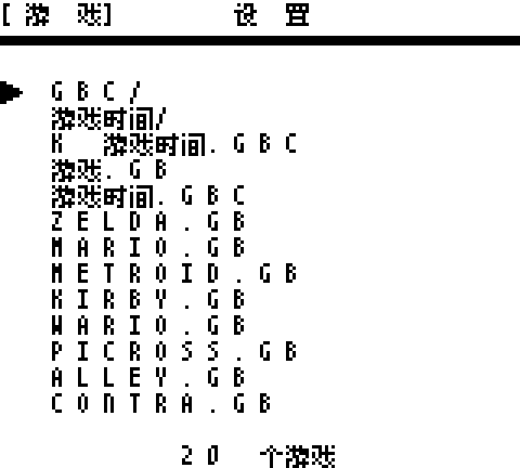
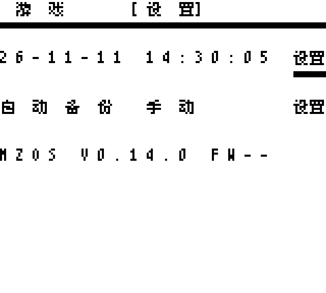
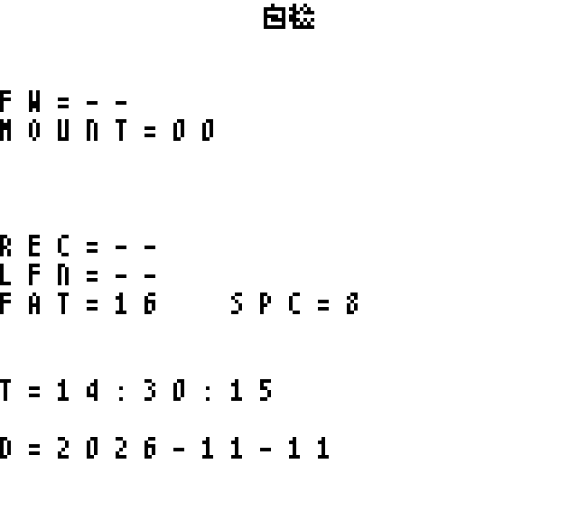

# ezjr-mini-kernel

**EZ-Flash Junior 的开源内核**：128 KB / 8 bank、中文界面、能列出卡上的游戏、能启动、
能把存档按中文名存回 SD 卡。

它不是官方固件的补丁，而是一个**从零写的内核**（C + 少量 sm83 汇编），直接替换 SD 卡
根目录的 `ezgb.dat`。目标场景是 **EZ-Flash Junior + FW5 固件 + 想要中文界面**。

> **请勿使用此项目更新烧录卡的固件。如有损坏，概不负责。**
>
> 本项目只产出一个 **SD 卡根目录上的内核文件 `ezgb.dat`**，由卡上已有的 stage1 引导
> 加载，全程**不写入卡带内部**；仓库里既没有固件镜像，也没有刷写工具，**做不到也不该
> 用来刷固件**。固件升级请走 EZ-FLASH 官方渠道，与本项目无关。

> 官方 1.04c 中文内核在 FW5 上不写游戏时钟基准（`$A018-$A01C` 的 `base`）：FW4 时代由
> FPGA 硬件透传，FW5 改成 `base + elapsed` 之后，MBC3+TIMER 游戏（宝可梦水晶等）的
> 时钟就从头开始算。本项目用另一条路解决同一类问题——**不再给官方内核打补丁，而是
> 自己写一个内核**，把想做的功能做干净。

| | |
|---|---|
|  |  |
| 双标签列表（长名、目录在前、按名升序） | 设置页：时间 + 自动备份开关 |
|  |  |
| 备份进度与结果同屏 | `--diag` 版自检屏（真机排障用） |

---

## 现在能做到什么

**核心链路已在真机跑通**（EZ-Flash Junior / FW5 / FAT16 SD 卡）：SD 读、FAT 挂载、
列表与中文名、启动游戏、中文名 `.sav` 备份、上次运行记录、RTC 读写。
表里标「待验」的是代码完成但还没在硬件上做过对照的项。

### 浏览与启动

| 能力 | 说明 |
|---|---|
| 双标签 UI（游戏 / 设置） | SELECT 切换；↑↓ 移光标、←→ 翻页 |
| 子目录浏览 | 文件夹名后带 `/`、排在文件前面；A 进入、B 返回，最多 4 层 |
| 按文件名升序 | 目录组、文件组各自升序；`..` 恒在第 0 格；稳定排序，同名保持卡上顺序 |
| **中文长文件名** | VFAT LFN 原样按 UTF-16 搬运，不需要 GBK→Unicode 码表；文件夹、`.GB`、`.GBC` 三种短名形状都能配上 |
| 启动游戏 | 装配加载命令表 → 10 个寄存器 → WRAM handoff → `$7FE0` 复位 |
| **START 菜单** | 「运行上次游戏」按「目录簇 + 完整 8.3 名」直接启动，不切目录、不重扫列表（真机通过）；「删除当前文件」连 VFAT 长名项和簇链一起清（主机侧验证） |

### 存档

| 能力 | 说明 |
|---|---|
| 存档落盘到 `SAVER/` | `根/SAVER/<ROM 名>.sav`，后缀小写；`SAVER` 全卡只一个、固定在根目录 |
| **`.sav` 用中文全名** | 与 ROM 长名逐字同名，只换扩展名；36 字符中文名要 3 条 LFN 项 + 短名 + 终止符 |
| 目录满了自动扩簇 | 照 FatFs 的 `dir_alloc` 重写：`$E5` 与 `$00` 同等当空槽，写满就 `create_chain` 加一簇，**不再报「目录已满」** |
| 延迟备份 | 游戏内存档留在 PSRAM，下次开机按 A 才写卡（也可设为自动） |
| **读档只认长名** | 存档身份就是「和 ROM 同名、只换扩展名」这一条，短名（`S1A2B3C4.SAV` / 别人的 `SLZ2~1.SAV`）一概不看；**只扫根目录的 `SAVER/`**（存档位置只有这一处），最多 16 个扇区，ASCII 不分大小写（[docs/07](docs/07-save.md#12-读档怎么认名字只认长名v01612)） |
| 只备份一次 | 内容指纹相同就一个字节都不写，电脑上换过的 `.sav` 不会被盖回去 |
| 电池没电不备份 | 官方同址同值的哨兵 `$11:$A201 = $88`；读不到就保住卡上的好存档，也不弹确认屏 |
| 上次运行的游戏 | 带校验、写两份的 18 字节记录（`$11:$A300` / `$A320`），开机现查长名 |
| 游戏内 RTC 基准 | 启动前把 PCF8563 的时间写进页 6 `$A018-$A01C`（MBC3+TIMER；代码完成，**真机待验**） |

### 系统

| 能力 | 说明 |
|---|---|
| 中文界面 | 86 个界面汉字，8×8 一字一格（Fusion Pixel Font 8px），按需上传 VRAM |
| 读 PCF8563 | 页 6 `$A008-$A00E` BCD，含 `VL` 掉电检测 |
| 设置时间 | 改字段 → 写回 PCF8563（`$7FD0=1` 触发 PicoBlaze I2C）；星期由年月日实时推算 |
| 提示全中文 | 错误原因、备份进度/结果都是中文，不显示 `ERR=n` |
| 版本行 | 设置页显示 `MZOS V0.16.15 FW5`，版本号与发布 tag 同步 |
| 真机自检屏 | 仅 `--diag` 版编入：一屏读出 FW / MOUNT / SD / FAT / RTC / 上次运行记录 |

---

## 快速开始

```sh
# 依赖：SDCC 4.2（带 sm83 后端）、Python 3；主机测试另需 gcc，模拟器测试需 pyboy
sudo apt-get install sdcc build-essential

./build.sh                    # -> build/ezgb.dat（128 KB，正式版）
./build.sh --diag             # 带真机自检屏（约 +1.4 KB，日常不要带）
EZJR_TEST=1 ./build.sh        # -> build/ezgb-test.dat（模拟器自检版，勿上卡）
```

装卡：

1. 备份卡上原有的 `ezgb.dat` 与整个 `SAVER/`；
2. 把 `build/ezgb.dat` 和 **`EZJR.FNT`**（汉字字库，中文文件名要用）拷到 SD 卡**根目录**；
3. 开机，看设置页版本行是不是 `MZOS V0.16.15 FW5`。

`EZJR.FNT` 是生成物（U+4E00–U+9FFF 全量，164 KB），不入版本库，从 Release 附件下载，
或本地生成：

```sh
# 需要 Fusion Pixel Font 8px ttf（SIL OFL 1.1）
EZJR_FONT=/path/to/fusion-pixel-8px-monospaced-zh_hans.ttf python3 tools/gen_cjk_fnt.py
```

不自带 `EZJR.FNT` 也能开机，只是中文文件名会退回 8.3 短名。

### 验证

```sh
sh tools/verify_all.sh            # 构建 + 静态 + 主机侧 + 模拟器，共 295 项断言
python3 tools/emu_test.py         # 只跑模拟器（PyBoy 无头，需 pip install pyboy）
```

真机测试步骤、自检屏判读、故障对照见 **[docs/05-hardware-test.md](docs/05-hardware-test.md)**。

---

## 仓库结构

```
.
├── build.sh                   一键构建（正式版 / --diag / EZJR_TEST=1）
├── src/
│   ├── crt0.s                 启动：中断向量、_HEADER、栈、gsinit、跳 _main
│   ├── launch.s               启动游戏的 handoff（复制进 WRAM 执行）
│   ├── hw.h / fpga.c/.h       GB 与 FPGA 寄存器、unlock/commit、SD 读写、joypad、固件版本
│   ├── fat.c/.h               FAT16/FAT32 挂载、目录扫描、8.3 名解析、排序、LFN 回配
│   ├── fatw.c                 FAT 写：簇链分配/释放、目录项分配与写入、目录扩簇、.sav 读写
│   ├── fatx.c                 建目录（SAVER）、删文件、按目录簇定位 ROM
│   ├── fatn.c                 按 8.3 名回扫目录取完整长名（.sav 同名用）
│   ├── save.c/.h              存档：PSRAM ↔ SD、指纹去重、电池哨兵、上次运行记录
│   ├── game.c/.h              启动游戏：读头、装配加载命令、写寄存器
│   ├── rtc.c/.h               PCF8563 读写、BCD、星期推算、游戏内 RTC 基准
│   ├── video.c/.h             LCD 初始化、8×8 双色阶 ASCII、汉字 tile 池
│   ├── fnt.c/.h               卡上字库 EZJR.FNT：按码点读字模
│   ├── main.c                 双标签状态机 + START 菜单，非阻塞主循环
│   ├── diag.c/.h              真机自检屏（EZJR_DIAG=0 时不参与编译）
│   ├── test_stub.c            仅 EZJR_TEST 构建：替掉 SD 与 RTC 窗口
│   ├── font_data.h            自动生成：86 汉字 + 11 符号 + 95 ASCII
│   └── strings.h              自动生成：中文文案 → glyph id 序列
├── tools/                     构建辅助、主机侧测试、模拟器测试（见下表）
└── docs/                      架构、构建、验证、边界、真机测试、存档、UI、中文文件名
```

| 工具 | 作用 |
|---|---|
| `gen_font.py` / `gen_cjk_fnt.py` | 渲染界面点阵并生成 `strings.h` / 生成卡上 `EZJR.FNT` |
| `fix_header.py` / `verify_rom.py` | 填 GB 头（替代缺失的 rgbfix）/ ROM 结构与段布局静态校验 |
| `fat_host_test.py` / `save_host_test.py` / `window_host_test.py` | 在主机上用构造的 FAT 镜像跑真实 C 代码 |
| `rtc_host_test.py` / `launch_host_test.py` / `fpga_host_test.py` | BCD 与 3600 日期差分 / 加载命令表 / 寄存器序列 |
| `emu_test.py` | PyBoy 无头驱动：界面、按键、备份全链路 |

---

## 五个关键设计决定

1. **C 为主，汇编只做 C 表达不了的部分**。`crt0.s`（向量/头/栈/gsinit）与 `launch.s`
   （必须搬进 WRAM 才能执行的 handoff）。业务逻辑 100% C，能编译、能在主机上单测。
2. **中文字库不从官方内核抠**。官方 1.04c 的 34 banks 里约 384 KB 是专有点阵，不能复制。
   这里用 **Fusion Pixel Font 8px（SIL OFL 1.1）** 渲染界面用到的 86 个字，一个汉字
   正好占一个 8×8 tile（8 字节），一屏 360 格全可用汉字。
3. **FAT 写路径照 FatFs 的算法重写，但不链接 FatFs**。官方内核用 ChaN 的 FatFs，可是
   它 160 KB / 10 banks 才装得下；32 KB 装不下整套。所以只抄算法（`dir_alloc` 把 `$E5`
   与 `$00` 同等当空槽、`dir_next(stretch)` 扩簇），实现自己写。
4. **存档名 = ROM 长名换扩展名**。卡上的加载器靠这个名字配对，所以 `.sav` 必须与 ROM
   逐字同名；写之前回目录重读完整长名，不在 PSRAM 里存副本（那份副本真机读不回来）。
5. **写 VRAM 等 VBlank（mode 1），不等 mode 3 结束**。mode 3 之后的 HBlank 只有 204 周期，
   从读完 STAT 到字节落进 VRAM 要 20 多周期，踩到末尾就整格被吞，屏幕上就是
   `PO EMON.GB` 这种断字。

---

## 验证状态（诚实版）

| 层级 | 内容 | 结果 |
|---|---|---|
| 静态 | ROM 头、logo、两道校验和、段布局不重叠、`_DATA` 不撞 handoff 区 | ✅ |
| 主机侧 | FAT16/FAT32 镜像列目录与写盘、中文长名、目录扩簇、BCD 往返、3600 日期差分、加载命令表 | ✅ 295 项 |
| 模拟器（PyBoy） | 真启动、LCD/字库/汉字 tile、标签切换、↑↓ 翻页 + **←→ 整页翻**、时间编辑、备份屏全流程 | ✅ |
| **真机** | SD 读、FAT 挂载、PCF8563 读写、启动游戏、**中文名 `.sav` 备份**、上次运行、删除 | ✅ |

PyBoy 里没有 EZ-Flash 的 FPGA（`$7Fxx` 解锁、SD、PCF8563 都无效），所以模拟器层证明的
是**界面与状态机**，硬件层只能真机验。这一层已经在 FW5 的机器上逐项过完了。

---

## 容量：128 KB / 8 bank，一个功能组一个 bank

MBC5，bank N 在文件偏移 N × `$4000`，stage1 按文件大小加载。v0.16.6 起把代码按功能
组拆进独立 bank（[docs/12-bank-layout.md](docs/12-bank-layout.md)），跨 bank 调用走
`$0400` 的固定桩表 —— 好处是加功能时只动某一个 bank，不用再把常驻段挤爆。

| 段 / bank | 范围 | 内容 | 余量 |
|---|---|---|---|
| `_CODE`（bank0） | `$0400-$2899` | 主程序、显示、SD 读、中文名 | 5990 |
| `_BANK1`（bank1） | `$4000-$6F18` | FAT 读/写、存档流程、启动、RTC | 4327 |
| bank2 | `$4200-$653A` | `.SAV` 写路径（`fatw.c`，含建目录） | 6853 |
| bank3 | `$4200-$4E4E` | 备份/读档流程（`save.c`） | 12721 |
| bank4 | — | 自检屏，**只有 `--diag` 版**（603 字节） | — |
| bank5 | `$4000-` | 汉字点阵（`BANKFONT`，只在读字时切） | — |
| `_DATA` | `$C000-` | 全局变量，3759 / 3840 字节 | 81 |

`bank6` / `bank7` 还空着（bank7 留给临时诊断代码）。ROM 文件固定 128 KB，硬件上限是
256 × 16 KB（官方 160 KB / 10 banks、mod 版 256 KB / 16 banks 都是真机在跑）。

---

## 许可与上游关系

- **代码：AGPL-3.0**（见 [LICENSE](LICENSE)）。选它是因为上游生态（[lukesau/ezgb](https://github.com/lukesau/ezgb)）
  同为 AGPL-3.0，保持同向最省事；本项目的代码是独立实现，法律上并不被强制。
- **界面点阵与 `EZJR.FNT`**：派生自 **Fusion Pixel Font 8px**（TakWolf，SIL OFL 1.1），
  随仓库按 OFL 分发，见 [NOTICE.md](NOTICE.md)。
- **不是 lukesau/ezgb 的 fork**，也没有复制它的任何源码、Verilog 或反汇编文本。只用到了
  不受版权保护的事实性信息（寄存器地址、协议时序、页窗口语义、启动契约），逐条列在
  [NOTICE.md](NOTICE.md) 第 3 节。原因与取舍见 [docs/11-license-and-upstream.md](docs/11-license-and-upstream.md)。
- **不含**任何 EZ-FLASH 官方固件、官方字库、游戏 ROM 或存档。

## 免责声明

**请勿使用此项目更新烧录卡的固件。如有损坏，概不负责。**

本项目的作用域只有 SD 卡上的一个文件（`ezgb.dat`）：它由卡带里已有的 stage1 引导
加载，**不触碰卡带内部存储，也不涉及固件**。仓库不含任何固件镜像或刷写工具。

改内核、写 SD 卡仍有变砖或丢存档的风险。上卡前请备份原 `ezgb.dat` 和整个 `SAVER/`。
本项目按现状提供（AS IS）、不提供任何担保，使用风险自负。
